<a href="https://thibautvermersch.github.io/Portfolio/" target="_blank">
  <picture>
    <source media="(prefers-color-scheme: dark)" srcset="./assets/terminal-dark.svg">
    <source media="(prefers-color-scheme: light)" srcset="./assets/terminal-light.svg">
    
  </picture>
</a>

### ⭐ Compétences Techniques 

<table> <tr> <td valign="middle" align="center" width="130" nowrap><b>🎨&nbsp;Frontend</b></td> <td> <table><tr> <td align="center" width="90"> <b>HTML5</b></td> <td align="center" width="90"> <b>CSS3</b></td> <td align="center" width="90"> <b>JavaScript</b></td> </tr></table> </td> </tr> <tr> <td valign="middle" align="center" width="130" nowrap><b>⚙️&nbsp;Backend</b></td> <td> <table><tr> <td align="center" width="90"> <b>PHP</b></td> <td align="center" width="90"> <b>Laravel</b></td> <td align="center" width="90"> <b>Flask</b></td> <td align="center" width="90"> <b>Java</b></td> <td align="center" width="90"> <b>Python</b></td> <td align="center" width="90"> <b>Bash</b></td> </tr></table> </td> </tr> <tr> <td valign="middle" align="center" width="130" nowrap><b>🗄️&nbsp;Données</b></td> <td> <table><tr> <td align="center" width="90"> <b>PostgreSQL</b></td> <td align="center" width="90"> <b>SQL</b></td> </tr></table> </td> </tr> <tr> <td valign="middle" align="center" width="130" nowrap><b>💻&nbsp;IDE</b></td> <td> <table><tr> <td align="center" width="90"> <b>VS Code</b></td> <td align="center" width="90"> <b>IntelliJ IDEA</b></td> <td align="center" width="90"> <b>PhpStorm</b></td> <td align="center" width="90"> <b>Eclipse</b></td> </tr></table> </td> </tr> <tr> <td valign="middle" align="center" width="130" nowrap><b>🛠️&nbsp;Outils</b></td> <td> <table><tr> <td align="center" width="90"> <b>Git</b></td> <td align="center" width="90"> <b>Linux</b></td> </tr></table> </td> </tr> </table>

### 🚀 Projets mis en avant

  
  
   
  
  
   
  
  

### 📊 Statistiques GitHub

  
  

<picture>
  <source media="(prefers-color-scheme: dark)" srcset="https://raw.githubusercontent.com/ThibautVermersch/ThibautVermersch/output/snake-dark.svg">
  <source media="(prefers-color-scheme: light)" srcset="https://raw.githubusercontent.com/ThibautVermersch/ThibautVermersch/output/snake.svg">
  
</picture>

### 📫 Me contacter

  
  
  

